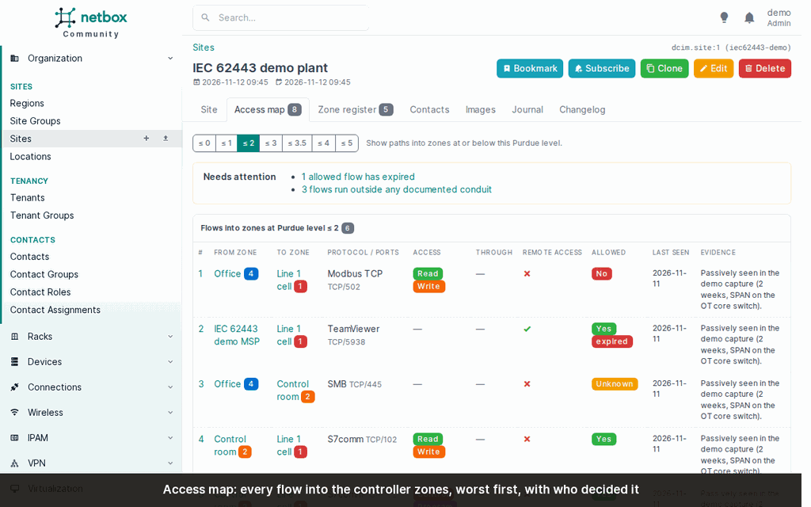

# netbox-iec62443

**See who can reach your PLCs, and record who decided that is allowed: IEC 62443 zones, conduits and flows in
NetBox.**

[](https://pypi.org/project/netbox-iec62443/)
[](https://github.com/Packetflow-be/netbox-iec62443/actions/workflows/ci.yml)
[](https://github.com/Packetflow-be/netbox-iec62443/blob/main/LICENSE)

A NetBox plugin for OT networks. It models **IEC 62443 zones and conduits**, the **flows** that run through
them, and **Purdue levels** on devices and virtual machines. On top of that it builds an **access map**: every
known flow into the controller zones, each with an "allowed?" verdict and who decided it.

It is meant for the people who run production networks: plant and maintenance engineers, OT/IT teams and the
integrators who work for them. Keep zones, conduits and industrial protocols in the same NetBox as the rest of
your inventory. See at a glance who can reach the PLCs, including supplier remote access over 4G routers,
TeamViewer, VPN or an MSP's jump host, and decide per flow whether that is allowed. Then hand an auditor the
zone register.



## Features

- **Zones and conduits** per IEC 62443-3-2: zone types (OT, safety/SIS, DMZ, enterprise, supplier), Purdue
  levels, SL-T and SL-A vectors over the seven foundational requirements, accountable people, sub-zones, the
  devices that enforce a conduit, and risk assessments. [Data model](https://github.com/Packetflow-be/netbox-iec62443/blob/main/docs/data-model.md)
- **Flows**: what actually runs from one zone into another (protocol, ports, read/write/control/program access,
  remote access, the path of hops it takes) with a verdict: allowed yes/no/unknown, decided by whom, review
  and expiry dates.
- **Access map** per site: the flows into the controller zones, worst first, with what needs attention and a
  diagram. [Access map](https://github.com/Packetflow-be/netbox-iec62443/blob/main/docs/access-map.md)
- **Consistency checks** and a printable **zone register** (CSV, JSON) for the audit, also as an API and a
  command with an exit code for CI. [Checks and register](https://github.com/Packetflow-be/netbox-iec62443/blob/main/docs/checks-and-register.md)
- **Industrial services and fieldbuses**: Modbus, S7comm, PROFINET, EtherNet/IP, OPC UA, DNP3, IEC 61850 and
  more, linked to NetBox application services. [Industrial systems](https://github.com/Packetflow-be/netbox-iec62443/blob/main/docs/industrial.md)
- **Importer** for passive captures: Zeek logs (with or without CISA ICSNPP) or a documented JSON format, with
  a list of the hosts NetBox does not know yet. [Importer](https://github.com/Packetflow-be/netbox-iec62443/blob/main/docs/importer.md)
- **Vendor-neutral firewall rules** from the allowed flows. [Firewall rules](https://github.com/Packetflow-be/netbox-iec62443/blob/main/docs/firewall-rules.md)
- REST API, GraphQL, filters, bulk import/edit, change log and permissions like any NetBox object.
  [API](https://github.com/Packetflow-be/netbox-iec62443/blob/main/docs/api.md)

## Compatibility

| Plugin | NetBox | Python |
|---|---|---|
| 0.2.x | 4.7.0 and later 4.7 releases; 4.8 allowed | 3.12, 3.13 |
| 0.1.x | 4.7.0 and later 4.7 releases; 4.8 allowed | 3.12, 3.13 |

CI runs the full test suite on NetBox 4.7.0, on the newest 4.7 release, and every week on NetBox's
development branch for the next release, so a NetBox change that breaks the plugin shows up before it ships.
`max_version` admits 4.8 on the strength of that weekly run; it is lowered again if the next release breaks
the plugin.

## Dependencies

None: no other NetBox plugins, Python packages, external software or services. The importer reads files that
other tools wrote; to import from network captures you need [Zeek](https://zeek.org/) (optionally with the
[CISA ICSNPP](https://github.com/cisagov/ICSNPP) parsers, or [Malcolm](https://github.com/cisagov/Malcolm),
which bundles both) somewhere, not on the NetBox server.

## Installation

For a NetBox installed from source in `/opt/netbox`:

```bash
cd /opt/netbox
echo "netbox-iec62443" | sudo tee -a local_requirements.txt
sudo venv/bin/pip install netbox-iec62443
```

Add the plugin to `/opt/netbox/netbox/netbox/configuration.py` (if `PLUGINS` already exists, add it to the
list):

```python
PLUGINS = ["netbox_iec62443"]
```

Create its tables and restart:

```bash
sudo venv/bin/python netbox/manage.py migrate
sudo venv/bin/python netbox/manage.py collectstatic --no-input
sudo systemctl restart netbox netbox-rq
```

An *IEC 62443* menu appears. To see it populated within minutes, create the fictional demo plant and open the
site *IEC 62443 demo plant* (`--delete` removes it again):

```bash
sudo venv/bin/python netbox/manage.py iec62443_demo
```

[netbox-docker](https://github.com/Packetflow-be/netbox-iec62443/blob/main/docs/installation.md#netbox-docker), the settings, permissions, upgrading and removing are in
[docs/installation.md](https://github.com/Packetflow-be/netbox-iec62443/blob/main/docs/installation.md).

## Documentation

The full documentation is in [docs/](https://github.com/Packetflow-be/netbox-iec62443/blob/main/docs/README.md); release notes are in [CHANGELOG.md](https://github.com/Packetflow-be/netbox-iec62443/blob/main/CHANGELOG.md).

## Getting help and contributing

- **Questions and how-to**: [GitHub Discussions](https://github.com/Packetflow-be/netbox-iec62443/discussions).
- **Bugs and feature requests**: [GitHub issues](https://github.com/Packetflow-be/netbox-iec62443/issues). Please
  include the NetBox and plugin versions.
- **Security issues**: privately, as described in [SECURITY.md](https://github.com/Packetflow-be/netbox-iec62443/blob/main/SECURITY.md), not in a public issue.
- **Code, documentation and translations**: see [CONTRIBUTING.md](https://github.com/Packetflow-be/netbox-iec62443/blob/main/CONTRIBUTING.md).

The plugin is maintained by [Packetflow](https://packetflow.be), a small company in Belgium, and is in alpha:
the data model may still change, and every breaking change comes with a migration and a **Breaking Changes**
note in the changelog.

## License

Code: Apache License 2.0, see [LICENSE](https://github.com/Packetflow-be/netbox-iec62443/blob/main/LICENSE). The icon (`docs/icon.svg`) is licensed under
[CC BY 4.0](https://creativecommons.org/licenses/by/4.0/).
