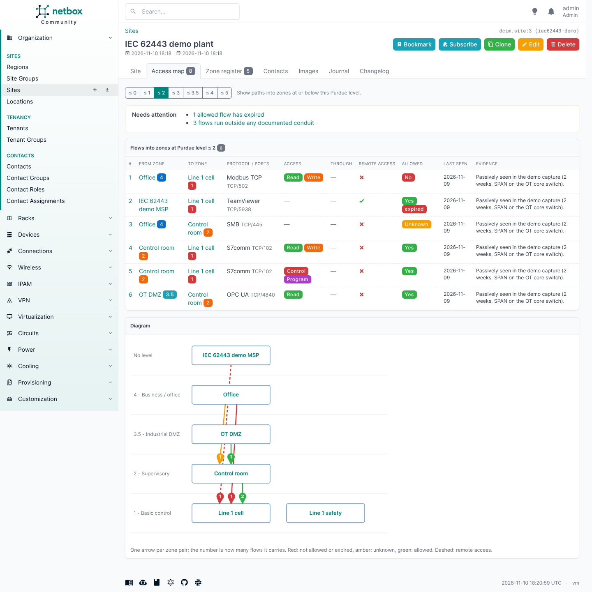
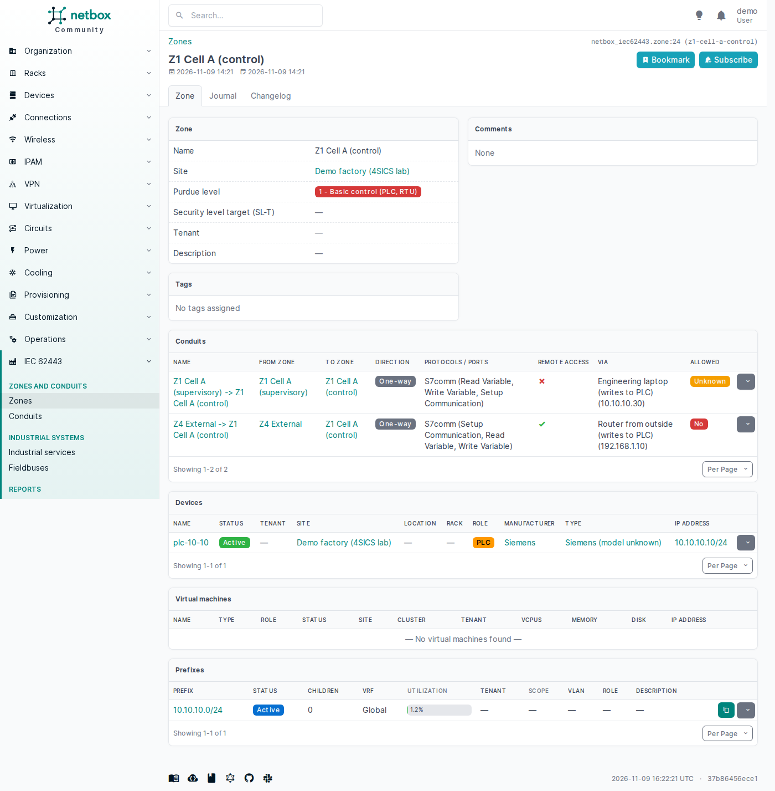
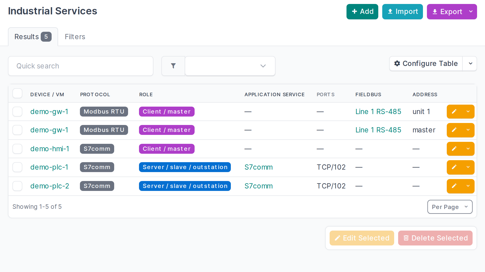

# netbox-iec62443

A NetBox plugin for OT networks: **IEC 62443 zones and conduits**, **Purdue levels** on devices and
virtual machines, and an **access map**: every known path into the controller zones, with an
"allowed?" verdict per path.

It is meant for the people who run production networks: plant and maintenance engineers, OT/IT
teams and the integrators who work for them. Keep your zones, conduits and industrial protocols in the
same NetBox as the rest of your inventory, see at a glance who can reach the PLCs (including supplier
remote access over 4G routers, TeamViewer or VPN), and decide per path whether that is allowed. It
also records industrial services (Modbus, S7comm, PROFINET, EtherNet/IP, OPC UA, DNP3, ...) and serial
fieldbuses.

Status: early development (0.1.0.dev0), tested on NetBox 4.7.2 and 4.7.4.







## What you get

- **Zone**: name, slug, site, tenant, Purdue level (0, 1, 2, 3, 3.5 DMZ, 4, 5), security level
  target (SL-T 0-4), member devices, virtual machines and prefixes, description, tags, comments.
- **Conduit**: source zone, destination zone, direction (one-way / two-way), **allowed** (yes / no /
  unknown), protocols/ports (free text), remote access flag, via (free text, e.g. "4G router of
  supplier X"), evidence, description, tags, comments.
- **Purdue level on devices and VMs** as a custom field (`iec62443_purdue_level`, group "IEC 62443").
- **Access map**: per site, all conduits into zones at Purdue level <= 2 (selectable), sorted with
  the not-allowed paths first, plus a small server-rendered diagram. Available as an "Access map" tab
  on the site page and under *IEC 62443 > Access map*.
- An **IEC 62443 panel on device and VM pages**: the asset's Purdue level, its zones and their conduits.
- The usual NetBox plumbing: list/detail/edit/delete, bulk import/edit/delete, filters, global search,
  change log, journal, REST API (`/api/plugins/iec62443/zones/`, `/conduits/`), GraphQL
  (`iec62443_zone_list`, `iec62443_conduit_list`).
- An **importer** for passive-capture analysis output (see below).

## Setup

Requires NetBox 4.7.x.

**NetBox installed from source** (`/opt/netbox`):

```bash
cd /opt/netbox
echo "netbox-iec62443 @ git+https://github.com/Packetflow-be/netbox-iec62443.git" | sudo tee -a local_requirements.txt
sudo venv/bin/pip install "netbox-iec62443 @ git+https://github.com/Packetflow-be/netbox-iec62443.git"
```

Add to `/opt/netbox/netbox/netbox/configuration.py`:

```python
PLUGINS = ["netbox_iec62443"]
PLUGINS_CONFIG = {
    "netbox_iec62443": {
        "create_custom_fields": True,     # create the Purdue level custom field after migrate
        "access_map_max_level": "2",      # default level filter of the access map
    },
}
```

```bash
sudo venv/bin/python netbox/manage.py migrate
sudo venv/bin/python netbox/manage.py collectstatic --no-input
sudo systemctl restart netbox netbox-rq
```

**[netbox-docker](https://github.com/netbox-community/netbox-docker)** (custom image, see its wiki on plugins):

```bash
echo "netbox-iec62443 @ git+https://github.com/Packetflow-be/netbox-iec62443.git" >> plugin_requirements.txt
cat >> configuration/plugins.py <<'PY'
PLUGINS = ["netbox_iec62443"]
PLUGINS_CONFIG = {"netbox_iec62443": {}}
PY
docker compose build --no-cache
docker compose up -d
```

**Check:**

```bash
curl -s -H "Authorization: Token $TOKEN" https://netbox.example.com/api/status/ | grep netbox_iec62443
```

**Import observations** (format in [docs/import-format.md](docs/import-format.md)):

```bash
sudo /opt/netbox/venv/bin/python /opt/netbox/netbox/manage.py iec62443_import ./observations --site <site-slug> --dry-run
sudo /opt/netbox/venv/bin/python /opt/netbox/netbox/manage.py iec62443_import ./observations --site <site-slug>
```

**Remove:** take `netbox_iec62443` out of `PLUGINS`, restart, then
`pip uninstall netbox-iec62443`. The plugin's tables stay until you drop them.

Permissions: users who view conduits also need view permission on zones (a conduit shows its zones).
For development against netbox-docker, see [docs/development.md](docs/development.md).

## Access map API

`GET /api/plugins/iec62443/access-map/?site_id=<id>[&max_level=<level>]` returns the site's access map as
data, for reports and other tools: the conduits into zones at that Purdue level or below (not allowed first, as
full conduit objects) and the same SVG diagram as the UI. Needs `view_conduit` and view access to the site.

## Industrial systems and protocols

- **Industrial services**: which industrial protocol a device or VM speaks, and as what: server
  (slave, outstation), client (master), both, publisher or subscriber. Over the network the service
  sits on an interface and ports (filled in from the protocol's usual ports when left empty: 502
  for Modbus TCP, 102 for S7comm, 44818 for EtherNet/IP, 4840 for OPC UA, ...). On a serial bus it
  sits on a fieldbus at an address (Modbus unit ID, PROFIBUS station, rack/slot).
- **Fieldbuses**: RS-485/422/232, PROFIBUS, CAN, HART, AS-i, IO-Link segments, with the protocol, the
  zone they belong to and the gateway that bridges them to Ethernet (a serial device server or
  protocol gateway). A passive network capture can't see these, so they are usually entered by hand.
  Commissioning settings such as baud rate and frame format are deliberately not recorded here.
- Protocols: Modbus TCP/RTU/ASCII, S7comm(-plus), PROFINET IO, PROFIBUS DP, EtherNet/IP (CIP),
  OPC UA/DA, DNP3, IEC 60870-5-101/104, IEC 61850 MMS/GOOSE, BACnet/IP and MS/TP, KNXnet/IP, MQTT,
  HART-IP, EtherCAT, CANopen, Omron FINS, MELSEC.
- Both have the usual list/detail/edit/bulk views, filters (by protocol, role, port, zone, site,
  fieldbus), REST API (`/api/plugins/iec62443/industrial-services/`, `/fieldbuses/`) and GraphQL. The
  device and VM panel lists an asset's services and the buses it is gateway for.
- The importer creates services from the analysis: a server for every protocol an asset answered or
  that the input names for it, a client for every protocol it sent requests in. An open port alone
  creates no service, because a port does not identify the protocol (port 102 is S7comm on a Siemens
  PLC and IEC 61850 MMS on a protection relay); the importer lists such ports for you to resolve.

## Design choices

- **Zone members are plain many-to-many fields** (`devices`, `virtual_machines`, `prefixes`) rather
  than a generic assignment model. That is the simplest thing NetBox supports end to end (forms,
  REST API, GraphQL, change log) and it lets an asset sit in more than one zone when reality is
  messy. The plugin does not enforce one zone per asset; the device panel shows all of them.
- **Purdue level on devices/VMs is a custom field**, created by the plugin after `migrate` if it does
  not exist (never overwritten afterwards, so you may relabel it). Nothing is added to core tables,
  and you get filtering, bulk edit and CSV import of that field for free. Set
  `create_custom_fields: False` to manage it yourself.
- **Purdue level values are strings** ("0" ... "5", "3.5"), so the DMZ level fits; "at or below
  level N" is computed from the choice list.
- **A conduit connects two different zones** (IEC 62443-3-2). Traffic inside a zone is not a
  conduit; if a path inside a zone matters (an engineering laptop writing to a PLC in the same cell),
  that usually means the zone should be split.
- **"Allowed" defaults to unknown.** Tools fill in evidence; a person decides yes or no.
- **A zone with conduits cannot be deleted.** Delete or move its conduits first, so verdicts and
  evidence are never lost as a side effect.
- Zone names and slugs are unique per site (and globally for zones without a site).

## Importer: observation files

```
manage.py iec62443_import <dir> --site <slug> [--vrf <name or RD>] [--user <name>] [--dry-run]
    [--outside-zone NAME] [--split ZONE ... | --split-all]
```

Reads observation files in the format described in [docs/import-format.md](docs/import-format.md)
(`assets.json`, `flows.json`, optionally `summary.json`): what was seen on the network, for example
from Zeek with the CISA ICSNPP parsers, Malcolm or an asset-discovery export.

One import covers **one site and one routing domain**. The same machine network (say 192.168.0.0/24
behind every OEM machine) is normal in OT, so the importer only matches devices, VMs and prefixes at
`--site` and in `--vrf` (default: the global table). Import captures from different VRFs separately.
It creates:

- a zone per zone name in the input, with the assets found there (matched to NetBox devices/VMs by
  primary IPv4 at the site and in the VRF; an address that matches more than one is skipped and
  reported), Purdue level = the lowest level among its assets;
- links to the prefixes NetBox already has for those assets (the most specific one, not a
  container). It never creates prefixes, and it leaves a prefix unlinked when it holds assets of
  more than one zone;
- a conduit per directed zone pair seen talking, with the OT protocols/functions that crossed it and
  the connection counts as evidence. Every OT request is classified as read, write, control or
  program by an explicit table per protocol (`netbox_iec62443/importers/functions.py`); *via* lists
  the assets that sent write, control or program requests or are marked as remote access, and
  *remote access* is set when an asset marked `remote_access` in the input sent requests across;
- the Purdue level custom field on the matched assets (only where it is still empty).

Options:

- `--vrf NAME_OR_RD` matches devices, VMs and prefixes in this VRF instead of the global table.
- `--outside-zone NAME` names the zone for addresses not in assets.json (default `Outside`).
- `--split ZONE` splits a zone that mixes Purdue bands into one zone per band, named
  `ZONE (control)` (levels 0-1), `ZONE (supervisory)` (2) and `ZONE (operations)` (3 and up), so the
  paths between them become conduits (e.g. an engineering laptop writing to a PLC in the same cell).
  Traffic counted for the whole zone goes to the part its OT requests point at, else to the most
  critical part. `--split-all` does this for every mixed zone.

Re-running refreshes evidence but never overwrites a conduit's "allowed" or a level someone set.
Changes are recorded in the change log under `--user` (default: the first superuser).

**Other sources (not built yet).** The importer is split in two: `build_plan()` turns input files
into an `ImportPlan` (zones with member IPs, conduits with evidence, services, per-asset levels), and
`apply_plan()` writes any plan to NetBox, resolving addresses to devices, VMs and prefixes within the
site and VRF. A Malcolm or plain Zeek importer only needs its own `build_plan`: aggregate `conn.log`
(and the ICSNPP protocol logs) by zone, and reuse `apply_plan()` unchanged. Malcolm already creates devices and prefixes in NetBox, so
such an importer could start from Malcolm's NetBox data and only add zones and conduits.

## Language

The plugin is written in English and every user-facing string goes through Django's translation
functions, so it follows the language of the NetBox install (`LANGUAGE_CODE`, or each user's
language preference) as soon as a translation exists. No translations ship yet; they would go in
`netbox_iec62443/locale/<lang>/LC_MESSAGES/django.po` (`manage.py makemessages -l <lang>` in the
plugin directory).

## Development

Tests follow NetBox's own test classes (`APIViewTestCases`, `ViewTestCases`, filterset mixins) and run
inside a NetBox installation with the plugin enabled:

```
python manage.py test netbox_iec62443 --keepdb
```

Query-count baselines live in `netbox_iec62443/tests/query_counts.json` (re-record with
`UPDATE_QUERY_COUNTS=1`). See `docs/development.md` for the netbox-docker workflow.

## License

Apache License 2.0, see [LICENSE](LICENSE).
