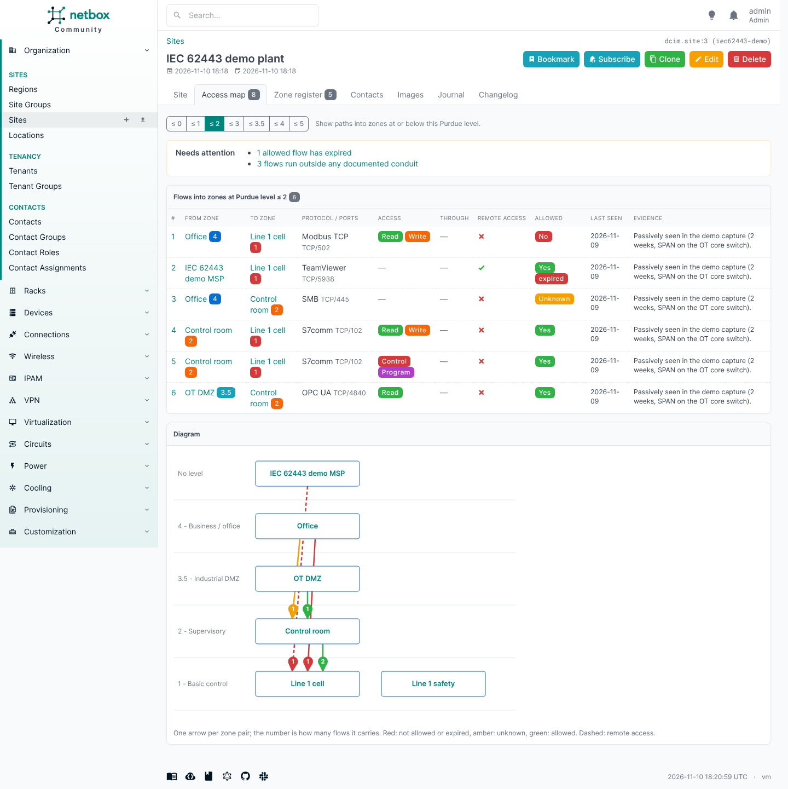

# Access map

The access map answers one question per site: **who can reach the controllers, and did someone decide that
is allowed?**

- It lists every flow into zones at Purdue level 2 or below. The level is selectable (≤ 0 ... ≤ 5), and its
  default is the `access_map_max_level` setting.
- Flows are ordered by what needs action: not allowed first, then allowed but expired, unknown, and allowed.
- Each row shows the source and destination zone with their levels, the protocol and ports, the access the
  requests had (read, write, control, program), the hops it runs through, remote access, the verdict, when the
  flow was last seen and the evidence.
- **Needs attention** sums up expired access, verdicts due for review, flows not seen for `stale_after_days`
  (default 90), flows that run outside any documented conduit, and flows that reach their zone over a connection
  opened from inside it (reverse connect, a broker: see [Connection models](data-model.md#connection-models)).
- A flow with another [connection model](data-model.md#connection-models) than client/server shows it under the
  protocol, with the broker's zone and the topics.

It is an *Access map* tab on the site page and a standalone page under *OT > Access map*. It needs the
`view_flow` permission.

## Filters

The form above the map narrows it down, and the diagram and the table always show the same flows:

| Filter | Shows |
|---|---|
| Into zones at Purdue level up to | Flows into zones at that level or below (default: the `access_map_max_level` setting) |
| Allowed | Not allowed, allowed but expired, unknown, allowed: one or more |
| Zone | Flows from, into or brokered in these zones: a zone and its neighbours |
| Protocol, Connection | One or more protocols or [connection models](data-model.md#connection-models) |
| Remote access | Only remote access, or only the rest |
| Draw sub-zones inside their parent zone | One box per top-level zone; flows between its sub-zones are counted in the box |
| Draw zones without flows | Also the zones of the site that no shown flow touches (left out by default) |

Every filter is a URL parameter (`?max_level=5&verdict=no&verdict=unknown&collapse=on`), so a filtered map can be
bookmarked, linked from a report or printed as it is.

## Diagram

The diagram is drawn per site; the page for all sites lists the flows only.

- Purdue levels are the rows, 5 at the top. A level with more than six zones wraps into several rows.
- There is one arrow per zone pair and direction, from the side that acts to the side acted upon: red for not
  allowed or expired, amber for unknown, green for allowed; dashed for remote access, dotted when the
  destination opens the connection itself. An arrow that carries several flows is thicker and shows how many,
  per colour.
- Arrows that skip a level run through the gaps between the zones in between, not behind them, and the zones
  of a row are ordered so that arrows cross as little as possible.
- Click a zone to highlight it with its arrows and neighbours and to list its flows under the diagram, with a
  link that shows only that zone and its neighbours. Click an arrow for the flows it carries. Escape or a
  second click clears it.
- Zoom with the buttons or Ctrl + scroll, drag to move. *Fit* returns to the whole width, or to the smallest
  size at which the labels stay readable. *SVG* downloads the diagram as a file.

The diagram is rendered by the server as plain SVG: it prints with the page (the controls are left out) and
it also shows when JavaScript is off or NetBox's static files were not collected; a zone is then a link to
its page. The script that adds zoom and highlighting ships with the plugin; nothing is loaded from the
internet.

On a large plant, start from what needs a decision (*Allowed*: not allowed, expired, unknown) with sub-zones
drawn inside their parent, then open single zones. `manage.py ot_demo --large` creates a plant of 35 zones
and about 200 flows to try this on.

## API

`GET /api/plugins/ot/access-map/?site_id=<id>[&max_level=<level>]` returns the site's access map as
data, for reports and other tools: the flows into zones at that Purdue level or below, in access-map order,
as full flow objects with their hops. Needs `view_flow` and view access to the site. The diagram is only on
the page, not in the API.
