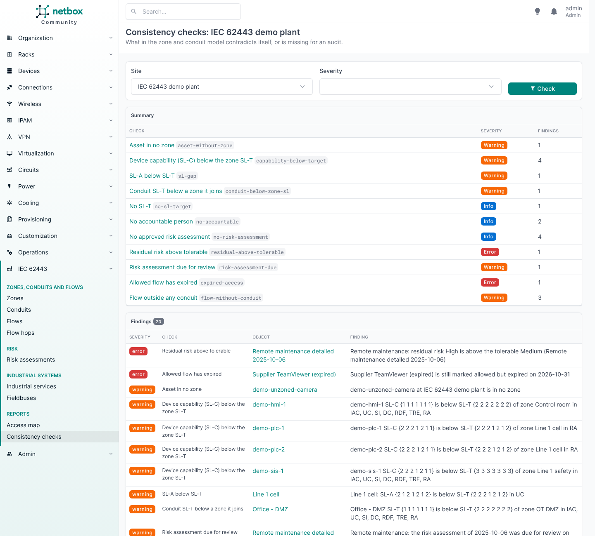
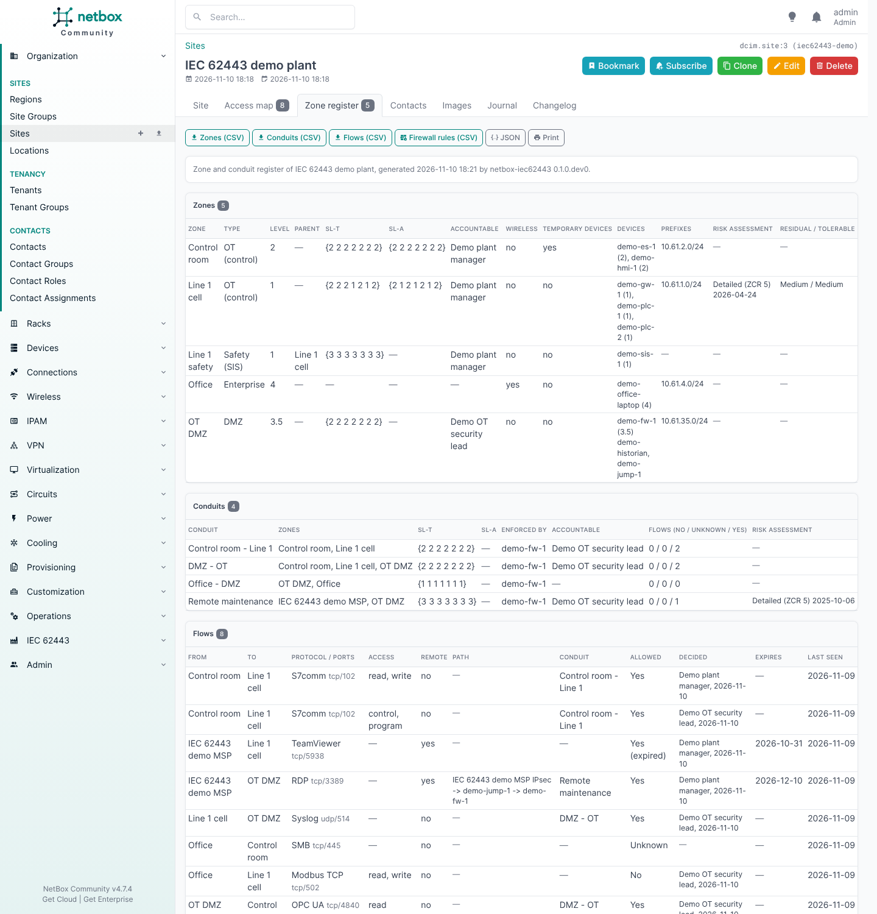

# Consistency checks and the zone register

## Consistency checks

*IEC 62443 > Consistency checks* lists what is inconsistent or missing in the model of a site:

- an address in another zone's prefix, an asset below its zone's level or in the wrong kind of zone, assets
  in no zone or in two;
- SL-A below SL-T, member SL-C below the zone's SL-T, a conduit below a zone it joins, conduits nobody
  enforces;
- expired or open-ended remote access, flows outside any conduit, verdicts without a decider, stale flows;
- residual risk above tolerable, overdue risk assessments;
- what an audit will ask for and is missing: no SL-T, no accountable person, no approved risk assessment.

Each finding has a check id, a severity (error, warning, info), a message and the object it is about.

From the API and the command line:

- `GET /api/plugins/iec62443/checks/?site_id=<id>[&severity=error,warning][&check=<id>,...]`: the findings of a
  site. Needs `view_zone`.
- `manage.py iec62443_check [--site <slug>] [--severity ...] [--check ...] [--fail-on error|warning|info|never]
  [--json]` runs the same checks and exits with status 1 when there is a finding at `--fail-on` or worse
  (default: error), so a nightly job or a CI pipeline can watch the model.

## Zone register

The *Zone register* tab on a site is the audit deliverable: the site's zones, conduits and flows with their
security levels, owners, risk and verdicts, plus the check results. It is printable, and exported as CSV per
table or as JSON.

`GET /api/plugins/iec62443/register/?site_id=<id>` returns the same register as JSON. Needs `view_zone`.
