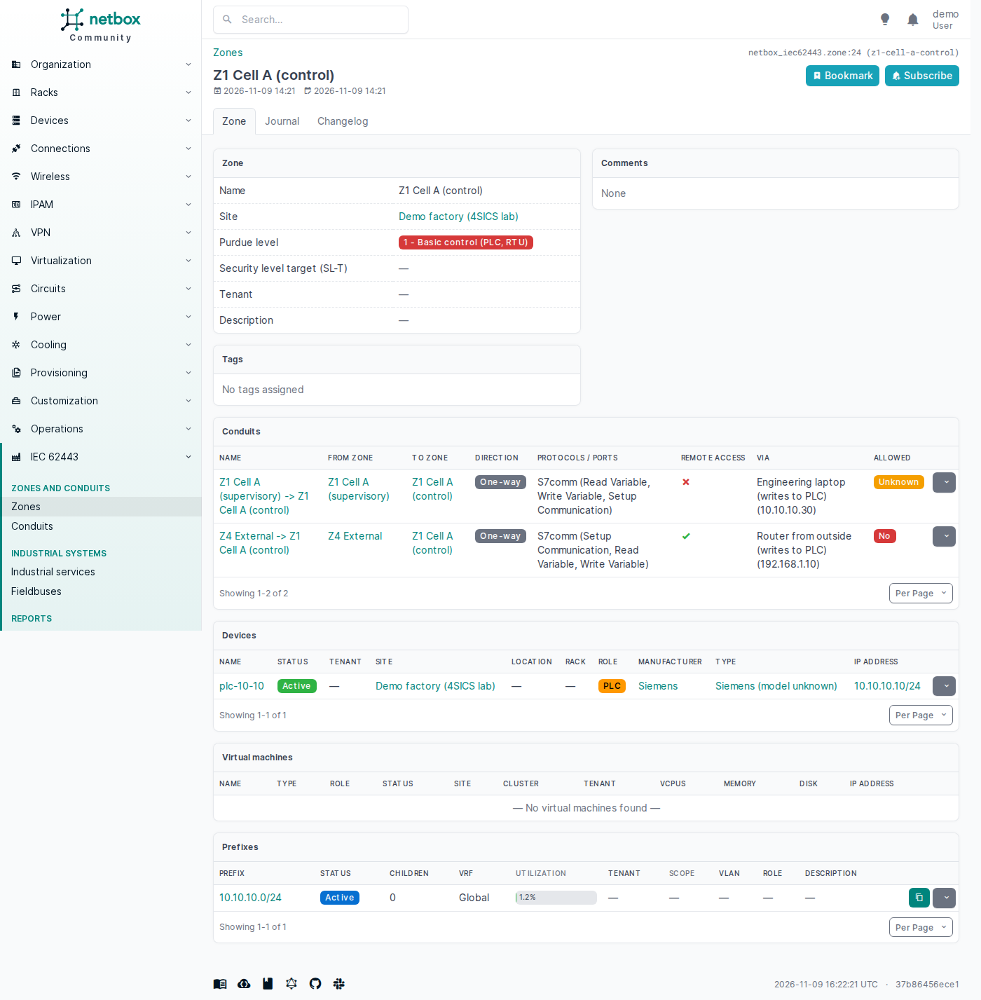
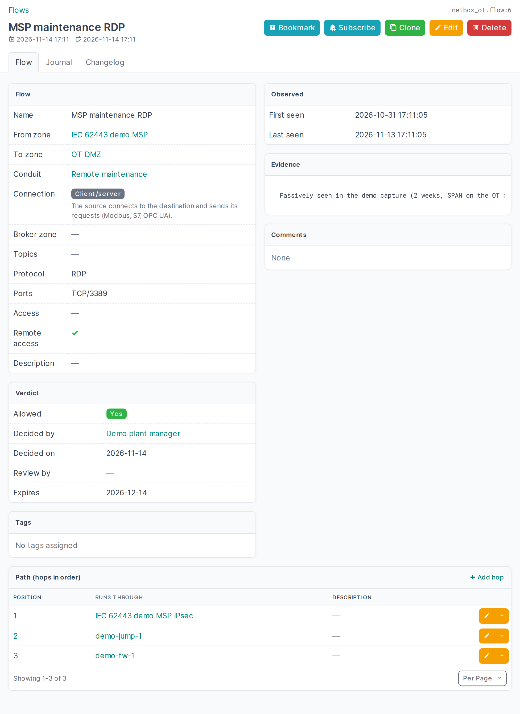

# Data model

## Objects

- **Zone**: name, slug, site, tenant, **type** (OT, safety/SIS, DMZ, enterprise, external/supplier),
  Purdue level (0, 1, 2, 3, 3.5 DMZ, 4, 5), **SL-T and SL-A as vectors** over the seven foundational
  requirements, the **accountable** person, parent zone (**sub-zones**), the IEC 62443-3-2 attributes
  **wireless** and **temporarily connected devices**, member devices, virtual machines and prefixes,
  description, tags, comments.
- **Conduit** (IEC 62443-3-2): the zones it joins (two or more), its own SL-T and SL-A vectors, the
  accountable person, and the devices and VMs that **enforce** it (firewalls, data diodes, gateways).
- **Risk assessment** (IEC 62443-3-2) of a zone or conduit: initial (ZCR 2) or detailed (ZCR 5), draft or
  approved, who assessed and approved it and when, next review, method, threats, vulnerabilities,
  consequences, countermeasures, **unmitigated, residual and tolerable risk**, a link to the report.
- **Flow**: what actually runs between two zones, in one direction: source and destination zone,
  **protocol** and **ports** (`tcp/102`), **access** (read, write, control, program), remote access
  flag, the **ordered path** it takes (hops: devices, VMs or tunnels), the conduit that carries it,
  first/last seen and evidence. Its verdict: **allowed** (yes / no / unknown), **decided by** (a NetBox
  contact) and **on**, **review by** and **expires**.
- **Industrial service** and **fieldbus**: see [Industrial systems and protocols](industrial.md).
- **Purdue level on devices and VMs** as a custom field (`ot_purdue_level`, group "IEC 62443"), and
  **SL-C** (security level capability) on devices and device types (`ot_sl_capability`, e.g.
  `2,2,2,1,2,1,1`; a device's own value overrides its type's).
- An **IEC 62443 panel on device and VM pages**: the asset's Purdue level, its zones and their flows,
  the conduits it enforces, the flows that run through it, its industrial services and the buses it is
  gateway for.

Every object has the usual NetBox plumbing: list/detail/edit/delete, bulk import/edit/delete, filters, global
search, change log, journal, tags, REST API and GraphQL (see [REST API and GraphQL](api.md)).

## Mapping a remote-access path

The flow model is also how you map a whole path, for example an MSP that reaches a PLC:

1. Make a zone of type *external / supplier* for the MSP.
2. Add a flow from that zone into the PLC's zone, protocol RDP or S7comm, remote access on.
3. Give it hops in order: the IPsec tunnel (a NetBox VPN tunnel), the jump host, the OT firewall.
4. Put it in the conduit that the firewall enforces.

"Every flow through the jump host" and "every remote flow that writes to a controller" are then plain
filters on the flow list (`hop_device_id`, `remote_access`, `modifying`).

## Design choices

- **A conduit is not a flow.** An IEC 62443-3-2 conduit groups the communication channels between two
  or more zones that share security requirements; it has its own SL-T and is enforced by devices. A flow
  is one directed path through it: protocol, ports, what the requests do, and a verdict. The access map
  and the importer work on flows; conduits are a design decision a person makes. A flow without a conduit
  is a path nobody documented, and the access map says so.
- **Flows are directed.** The source starts the conversation. A path that is opened from both ends is
  two flows, each with its own verdict, which is also what a firewall rule needs.
- **Zone members are plain many-to-many fields** (`devices`, `virtual_machines`, `prefixes`) rather
  than a generic assignment model. That is the simplest thing NetBox supports end to end (forms,
  REST API, GraphQL, change log) and it lets an asset sit in more than one zone when reality is
  messy. The plugin does not enforce one zone per asset; the device panel shows all of them.
- **Security levels are vectors.** SL-T and SL-A have one level (0-4) per foundational requirement, in
  order IAC, UC, SI, DC, RDF, TRE, RA, written `{2 2 2 1 2 1 1}`. Forms and CSV take one number for all FRs
  ("2") or seven ("2,2,2,1,2,1,1"); the REST API takes a list of seven. SL-C is a property of products, so it
  is a custom field on device types (with a per-device override), and the zone page shows the lowest SL-C of
  its members per FR next to the zone's SL-T and SL-A.
- **The safety (SIS) attribute is the zone type**, not a separate flag: a safety zone is its own zone type.
- **IEC 62443-3-3 requirement texts are not included.** They are copyrighted; the plugin does not track
  system requirements (SR 1.1 ...) yet.
- **A zone's Purdue level is its most critical (lowest) level.** A zone may hold a PLC (1) and an HMI (2);
  it counts as level 1, and the access map filters zones by it. The zone type says what kind of zone it is.
- **Purdue level on devices/VMs is a custom field**, created by the plugin after `migrate` if it does
  not exist (never overwritten afterwards, so you may relabel it). Nothing is added to core tables,
  and you get filtering, bulk edit and CSV import of that field for free. Set
  `create_custom_fields: False` to manage it yourself.
- **Purdue level values are strings** ("0" ... "5", "3.5"), so the DMZ level fits; "at or below
  level N" is computed from the choice list.
- **"Allowed" defaults to unknown.** Tools fill in evidence; a person decides yes or no. A verdict
  carries who decided it (a NetBox contact, so it can be someone without a NetBox login) and when; the
  date is filled in when the verdict changes. An allowed flow can expire (temporary supplier access) and
  can have a review date. Setting a flow back to unknown clears who and when.
- **Ports use NetBox's own `protocol/port` format** (`tcp/502`, `udp/47808`), the same as application
  services, and are empty for layer-2 protocols (PROFINET RT, GOOSE).
- **A zone with flows cannot be deleted.** Delete or move its flows first, so verdicts and evidence are
  never lost as a side effect. Deleting a conduit leaves its flows without one.
- **Risk assessments are records, not fields.** A zone or conduit keeps every assessment; the latest
  approved one is the one that counts for the register and the checks. A zone or conduit with risk
  assessments cannot be deleted.
- Zone and conduit names are unique per site (and globally for those without a site).
