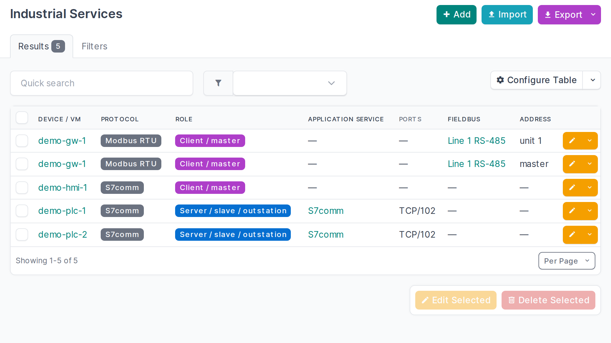

# Industrial systems and protocols

- **Industrial services**: which industrial protocol a device or VM speaks, and as what: server
  (slave, outstation), client (master), both, publisher or subscriber. Over the network its ports and IP
  addresses are those of a NetBox **application service** it links to, so they are stored once and show
  up in NetBox's own service views. On a serial bus it sits on a fieldbus at an address (Modbus unit ID,
  PROFIBUS station, rack/slot).
- **Fieldbuses**: RS-485/422/232, PROFIBUS, CAN, HART, AS-i, IO-Link segments, with the protocol, the
  zone they belong to and the gateway that bridges them to Ethernet (a serial device server or
  protocol gateway). A passive network capture can't see these, so they are usually entered by hand.
  Commissioning settings such as baud rate and frame format are deliberately not recorded here.
- Protocols: Modbus TCP/RTU/ASCII, S7comm(-plus), PROFINET IO, PROFIBUS DP, EtherNet/IP (CIP),
  OPC UA/DA, DNP3, IEC 60870-5-101/104, IEC 61850 MMS/GOOSE, BACnet/IP and MS/TP, KNXnet/IP, MQTT,
  HART-IP, EtherCAT, CANopen, Omron FINS, MELSEC. Flows also take the IT protocols seen on OT paths
  (RDP, SSH, VNC, TeamViewer, AnyDesk, IPsec, OpenVPN, WireGuard, HTTP(S), SMB, DNS, NTP, SNMP, Syslog).
- Both have the usual list/detail/edit/bulk views, filters (by protocol, role, port, zone, site,
  fieldbus), REST API (`/api/plugins/ot/industrial-services/`, `/fieldbuses/`) and GraphQL. The
  device and VM panel lists an asset's services and the buses it is gateway for.
- The [importer](importer.md) creates services from the analysis: a server for every protocol an asset
  answered or that the input names for it, a client for every protocol it sent requests in. An open port
  alone creates no service, because a port does not identify the protocol (port 102 is S7comm on a Siemens
  PLC and IEC 61850 MMS on a protection relay); the importer lists such ports for you to resolve.
