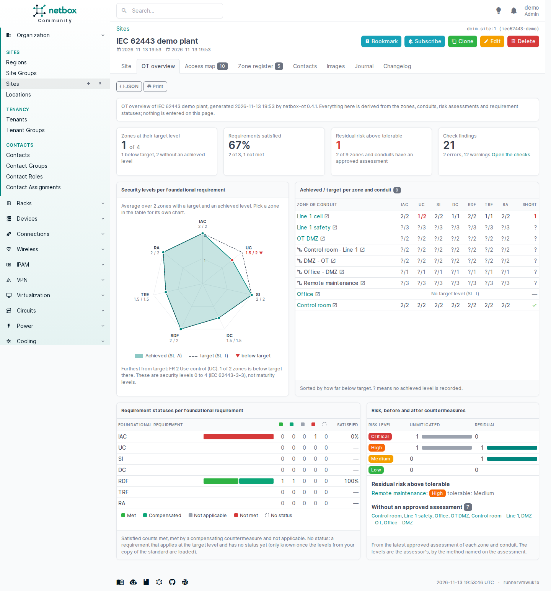

# OT overview

Every site with zones has an *OT overview* tab: where the site stands, on one page you can print. Nothing is
entered here. It is all derived from the zones, conduits, risk assessments and requirement statuses, so it is
as good as what is recorded there.

## Security levels per foundational requirement

The radar chart has one spoke per foundational requirement of IEC 62443 (IAC, UC, SI, DC, RDF, TRE, RA). The
dashed outline is the target level (SL-T), the filled shape the achieved level (SL-A). Where the shape stays
inside the outline, the site is below target; those spokes are marked in red with their numbers.

- For the site, both are the average over the zones that have a target and an achieved level. The text under
  the chart names the foundational requirement furthest from target and how many zones are below it there.
- Pick a zone in the table next to it for the chart of that zone alone.
- The outer ring is the highest level drawn (at least SL 2), so a plant with SL-T 2 fills the chart.

The table lists every zone and conduit as achieved/target per foundational requirement, sorted by how far
below target it is: first what is below target, then what has a target but no achieved level yet (`?`), then
what has no target, and last what is at target. *Short* is the number of levels short of target, summed over
the seven foundational requirements.

These are security levels (0 to 4, IEC 62443-3-3), not maturity levels. An average hides a weak zone behind
strong ones: read the chart for the shape and the table for the zone.

## Requirement statuses

Per foundational requirement: how many [system requirements](requirements.md) are met, met by a compensating
countermeasure, not applicable or not met, over all zones and conduits of the site. *Satisfied* counts the
first three. *No status* is a requirement that applies at the target level and has no status yet; the plugin
only knows that once you have loaded the levels from your own copy of the standard.

## Risk, before and after countermeasures

From the latest approved risk assessment of each zone and conduit: how many sit at each risk level before
countermeasures (unmitigated) and after (residual), which still have a residual risk above the tolerable
risk, and which have no approved assessment at all. The levels are the assessor's, by the method named on the
assessment; the overview only counts them.

## Check findings

The number of [consistency check](checks-and-register.md) findings for the site, with a link to them.

## As data

`GET /api/plugins/ot/overview/?site_id=<id>` returns the same numbers as JSON (add `&zone_id=<id>` for one
zone's levels). It needs the `view_zone` permission and counts only what the token's user can view.
