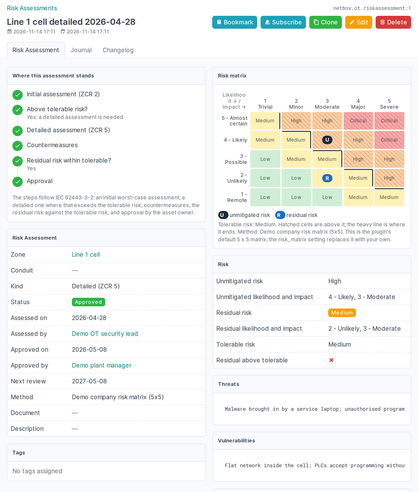

# Risk assessments



A risk assessment (IEC 62443-3-2) belongs to a zone or a conduit: the initial, worst-case one (ZCR 2) or the
detailed one (ZCR 5), with the unmitigated, residual and tolerable risk as low, medium, high or critical. A zone
or conduit keeps every assessment; the latest approved one counts for the register and the checks. This page
is about the two visual aids on the assessment's page.

## Where this assessment stands

The first panel lists the steps of an assessment and marks the one this assessment is at:

| Step | Done when |
|---|---|
| Initial assessment (ZCR 2) | The unmitigated (worst case) risk is recorded, here or in an initial assessment of the same zone or conduit |
| Above tolerable risk? | Unmitigated and tolerable risk are both recorded. If the unmitigated risk is within the tolerable risk, the next three steps are not needed |
| Detailed assessment (ZCR 5) | Threats are recorded (vulnerabilities, consequences, likelihood and impact stay listed as missing until they are filled in). On an initial assessment: a detailed assessment of the same zone or conduit exists (a button starts one) |
| Countermeasures | The countermeasures are recorded |
| Residual risk within tolerable? | The residual risk is recorded and not above the tolerable risk. If it is above, the step asks for a decision: more countermeasures, or an explicit acceptance |
| Approval | Status *Approved* with a date and who approved it |

Under the step it is at, it says what is still missing. The list of risk assessments has a *Step* column with the same
step, so you can see which assessments are waiting for what; the API has it as the read-only `current_step`.

The step names are the plugin's own words. The plugin does not ship the text of the standard.

## Risk matrix

Risk levels come from a matrix of likelihood by impact. Record the **likelihood** and the **impact** of the
unmitigated and of the residual risk, and the second panel shows the matrix with:

- **U** in the cell of the unmitigated risk and **R** in the cell of the residual risk;
- the cells above the tolerable risk hatched, and a heavy line where the tolerable risk ends.

With likelihood and impact given, the matrix gives the risk level: leave the level empty and it is filled in;
a level that contradicts the matrix is refused. Likelihood and impact are optional. An assessment without them
(every assessment made before this version) is as valid as before and shows its three levels on a plain scale
from low to critical instead.

### Your own matrix

Organisations use their own matrix; the *Method* field of an assessment names it. The default is a common
5 x 5. Replace it with the `risk_matrix` setting:

```python
PLUGINS_CONFIG = {
    "netbox_ot": {
        "risk_matrix": {
            # lowest first
            "likelihood": ["Rare", "Possible", "Likely"],
            "impact": ["Minor", "Serious", "Severe"],
            # one row per likelihood (lowest first), one level per impact (lowest first)
            "levels": [
                ["low", "low", "medium"],
                ["low", "medium", "high"],
                ["medium", "high", "critical"],
            ],
        },
    },
}
```

Two to nine steps per axis; the levels are `low`, `medium`, `high` and `critical`. NetBox refuses to start with
a matrix that does not fit this shape. Likelihood and impact are stored as numbers (1 is the lowest), so
changing the labels changes nothing, but changing the size or the levels of the matrix does not re-rate
existing assessments: their stored level stays until they are edited.

The default matrix (likelihood down, impact across):

| | 1 Trivial | 2 Minor | 3 Moderate | 4 Major | 5 Severe |
|---|---|---|---|---|---|
| 5 Almost certain | medium | high | high | critical | critical |
| 4 Likely | medium | medium | high | high | critical |
| 3 Possible | low | medium | medium | high | high |
| 2 Unlikely | low | low | medium | medium | high |
| 1 Remote | low | low | low | medium | medium |
